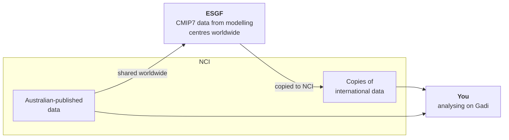

# Get set up on NCI

## How CMIP7 data reaches you

CMIP7 data is produced by modelling centres around the world and shared through the Earth System Grid Federation (ESGF), a global network of data nodes. Anyone can search ESGF and download data, but for most analyses that means moving very large volumes of data to your own machine.

NCI, Australia's node in this network, removes that step. It keeps a copy of a selection of international CMIP7 data on its own storage, and Australian modelling groups publish their CMIP7 data there too. Because this data sits right next to the Gadi supercomputer, you can analyse it directly without downloading anything.

To see exactly which data is available on NCI, see [What CMIP7 data is available?](../work-with-cmip7-data/data-available.md)

## Getting started

To start working with CMIP7 data on Gadi:

1. [Set up an NCI account](set-up-account.md), including access to a compute project
2. [Join CMIP7 projects](join-projects.md) for the data and analysis software
3. [Set up JupyterLab (ARE) for CMIP7](set-up-jupyterlab.md), including the session settings you need and where to save your outputs