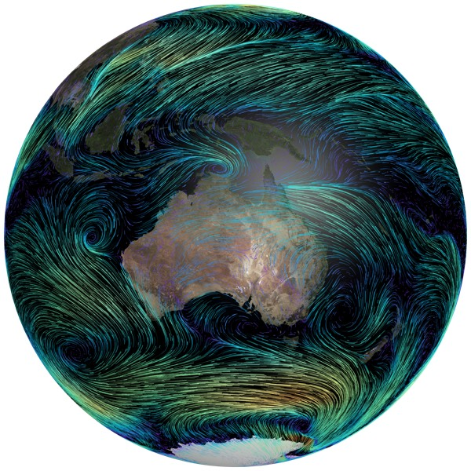

# Analyse and evaluate CMIP7 data

<figure class="float-figure">
  
  <figcaption>A visualisation of wind tracers in ACCESS-ESM1.6</figcaption>
</figure>

Once you've found your data with the [ACCESS-NRI Interactive Data Catalogue](../find-cmip7-data/find-and-access-data.md#access-nri-interactive-data-catalogue), you can work with it using whichever tools you prefer. This page assumes that you used this catalogue to find your data and get the code or file paths to load it on NCI's Gadi, but you don't have to: if you already have the file paths, or know how to load datasets with these tools, that works just as well! This page introduces a few tools that are already installed on Gadi and ready to use with CMIP7 data. It explains what each one is for and when you might choose it, then points you to their own documentation to learn more.

To understand the names and labels used to describe CMIP7 datasets, such as experiments, branded variables and grid labels, see [CMIP7 experiments and data standards](../about-cmip7/experiments-data-standards.md).

!!! tip "Just want to browse existing plots?"
    You don't need to analyse any data yourself to see how CMIP7 models perform. The [REF dashboard](https://dashboard.climate-ref.org/diagnostics?mip_era=CMIP7&view=cards) is a website, run by the global CMIP community, that anyone can browse.

## Which tool is right for me?

<object class="flow-diagram flow-diagram--work" data="../../assets/images/cmip7-work-with-data-flow.svg" type="image/svg+xml" aria-label="Flowchart: which tool to use to work with CMIP7 data on Gadi. Search for your data in the Interactive Data Catalogue, then copy the Intake + Xarray code or file paths for Xarray, the file paths for any other tool, the ESMValCore code for ESMValCore, or the ESMValTool recipe for ESMValTool. ILAMB is a separate workflow for land data with no code to copy from the catalogue."></object>

The table below is another way to view the information in the diagram above.

| Tool | Use it to | Copy from the catalogue | Run in |
|---|---|---|---|
| [Xarray](#work-in-a-jupyter-notebook-with-xarray) | Explore and plot data in a notebook | Intake + Xarray code, or file paths | ARE JupyterLab |
| [Any other tool](#use-any-other-tool-with-file-paths) | Work with the tools you already know, such as R, CDO or NCO | File paths | ARE JupyterLab or a PBS job |
| [ESMValCore](#esmvalcore-in-a-notebook) | Preprocess data in a notebook, e.g. regrid, subset or average | ESMValCore code | ARE JupyterLab |
| [ESMValTool](#esmvaltool-recipes) | Run diagnostics across many datasets and compare models with observations | ESMValTool recipe | A PBS job |
| [ILAMB](#benchmark-land-processes-with-ilamb) | Benchmark land processes against observations | Nothing: follow the ILAMB workflow | A PBS job |


## Before you start

??? info "Get set up to run these tools on Gadi"
    To run the tools on this page on Gadi, you will need to:

    1. **Have an NCI account.** If you don't have one yet, see [Set up an NCI account](../get-set-up-nci/set-up-account.md#1-nci-user-account).
    2. **Be a member of a compute project.** This gives you the computing time and storage to run your analysis. See [Get access to an NCI compute project](../get-set-up-nci/set-up-account.md#2-compute-project).
    3. **Join the NCI projects that hold your data:** `ib12` for international CMIP7 data, and `im55` for ACCESS model data. See [Join CMIP7 projects](../get-set-up-nci/join-projects.md#cmip7-projects).
    4. **Join `xp65`.** All the tools on this page are in the `conda/analysis3` environment, provided by ACCESS-NRI through the `xp65` project. It's listed with the [CMIP7 projects](../get-set-up-nci/join-projects.md#cmip7-projects).
    5. **Load `conda/analysis3`.** Select it when you start an ARE JupyterLab session (see [ARE settings for CMIP7](../get-set-up-nci/set-up-jupyterlab.md#are-settings-for-cmip7)), or load it in your PBS job script:

        ```bash
        module use /g/data/xp65/public/modules
        module load conda/analysis3
        ```

The examples on this page use monthly near-surface air temperature (`tas`) from the first `historical` run of ACCESS-ESM1.6. To follow along, open this [filtered search in the Interactive Data Catalogue](https://access-nri.github.io/interactive-data-catalogue/#/cmip?source_id_filter=ACCESS-ESM1-6&frequency_filter=mon&variable_id_filter=tas&experiment_id_filter=historical&variant_label_filter=r1i1p1f1).

## Work in a Jupyter notebook with Xarray

[Xarray](https://docs.xarray.dev/) is a Python library for working with labelled, multi-dimensional data such as climate model output. It's a good place to start if you want to explore a dataset, make quick plots, or build up your own analysis step by step in a Jupyter notebook.

Here, we highlight two ways to load data from the catalogue into Xarray. Both give you an Xarray Dataset to work with.

??? info "Copy the Intake + Xarray code"
    In the catalogue, open **Code examples for accessing data on NCI**, choose the **Intake + Xarray** tab, then select **Copy Intake + Xarray code**. The code uses the [ACCESS-NRI Intake catalogue](../find-cmip7-data/find-and-access-data.md#access-nri-intake-catalogue) to find and load the data for you, so you don't need to know where the files are. This is the easiest option, especially if your search matches several datasets.

    ??? example "Example: from Intake + Xarray code to a plot"

        The code the catalogue generates for the example search looks like this:

        ```python
        import re
        import intake
        from dask.distributed import Client

        client = Client(threads_per_worker=1)
        collections = ["cmip7_australian","cmip7_replicated"]
        selected = {
            "source_id": [
                "ACCESS-ESM1-6"
            ],
            "frequency": [
                "mon"
            ],
            "variable_id": [
                "tas"
            ],
            "experiment_id": [
                "historical"
            ],
            "variant_label": [
                "r1i1p1f1"
            ]
        }
        # Match each selected value exactly: choosing "tas" should not also select "tasmax".
        filters = {key: [f"^{re.escape(value)}$" for value in values]
                for key, values in selected.items()}

        catalogues = {}
        for name in collections:
            catalogue = intake.cat.access_nri[name]
            missing = set(filters) - set(catalogue.df.columns)
            if missing:
                raise ValueError(f"{name} cannot apply these filters: {sorted(missing)}")
            match = catalogue.search(**filters) if filters else catalogue
            if len(match.df):
                catalogues[name] = match
            print(f"{name}: {len(match.df)} matching files")

        if not catalogues:
            raise FileNotFoundError("No CMIP7 files at NCI match these filters")

        # Open matching files as Xarray datasets. Include the collection name in each key
        # so datasets with the same name from different collections are both kept.
        dataset_dict = {}
        for name, catalogue in catalogues.items():
            for key, dataset in catalogue.to_dataset_dict().items():
                dataset_dict[f"{name}:{key}"] = dataset
        dataset_dict
        ```

        `dataset_dict` is a dictionary of Xarray Datasets, one for each dataset that matches your search. Each key starts with the collection it came from (`cmip7_australian` for ACCESS model data, `cmip7_replicated` for international data), followed by a description of the dataset. To see which datasets were found, list the keys:

        ```python
        list(dataset_dict)
        ```

        Choose one, then plot it:

        ```python
        ds = dataset_dict["<dataset key>"]  # replace with one of the listed keys
        ds["tas"].isel(time=0).plot()       # plot the first time step
        ```

        If your search matches more datasets than you expect, add more filters in the catalogue (such as grid label or branded variable) and copy the updated code.

??? info "Copy the file paths"
    The catalogue gives you three ways to get file paths:

    - **Download all matching paths:** in **Code examples for accessing data on NCI**, choose the **File paths** tab, then select **Download all matching paths (.txt)**. This gives you a text file with one path per line, covering every dataset that matches your search.
    - **Copy a dataset's folder:** in the **NCI · Datasets on Gadi** results, each dataset row shows the path to its folder, with a button to copy it.
    - **View individual files:** select **View files** on a dataset row to see the paths of the individual files in that dataset.

    Then open the files with Xarray. This is useful when you know exactly which dataset you want, or want to see which files you're reading.

    ??? example "Example: open file paths with Xarray"

        Long model runs are split into several files by time period. `open_mfdataset` opens all the files in a folder and combines them into one Dataset:

        ```python
        import xarray as xr

        # Paste the path from the catalogue; replace vYYYYMMDD with the version it shows
        path = "/g/data/im55/publications/MIP-DRS7/CMIP7/CMIP/ACCESS-Consortium/ACCESS-ESM1-6/historical/r1i1p1f1/glb/mon/tas/tavg-h2m-hxy-u/g115/vYYYYMMDD/"
        ds = xr.open_mfdataset(path + "*.nc")

        ds["tas"].isel(time=0).plot()
        ```

        See [NCI file paths](../find-cmip7-data/find-and-access-data.md#nci-file-paths) for how the folders are organised and tips for working with them.

??? info "Learn more about Xarray"
    - [Xarray tutorial](https://tutorial.xarray.dev/): hands-on lessons, from the basics to working with large datasets
    - [Xarray plotting guide](https://docs.xarray.dev/en/stable/user-guide/plotting.html): how to make maps, time series and other plots
    - [Project Pythia Foundations: Xarray tutorial](https://foundations.projectpythia.org/core/xarray/): a beginner-friendly introduction to Xarray (and several other Python packages) for the geosciences

## Use any other tool with file paths

If you already have a workflow you like, you can use it with CMIP7 data on Gadi - you don't have to use any of the tools listed here! Get the file paths from the catalogue (download them all as a text file, copy a dataset's folder, or view its individual files, as described in [Copy the file paths](#work-in-a-jupyter-notebook-with-xarray) above) and use them with any tool that reads netCDF files, such as R, CDO, NCO or Iris. You can work interactively in ARE (for example, in a JupyterLab terminal) or in shell scripts and PBS batch jobs.

??? info "Find tools and file paths on Gadi"
    Many command-line tools are available on Gadi as modules; run `module avail` to see what's installed. See [NCI file paths](../find-cmip7-data/find-and-access-data.md#nci-file-paths) for how the folders are organised and tips for scripting with them.

## Use ESMValCore and ESMValTool

[ESMValTool](https://docs.esmvaltool.org/) is a community tool for evaluating Earth system models. It's designed for analyses that need to be **standardised and repeatable**: applying the same steps to many models, ensemble members or observational datasets, and recording them so that others can check and rerun your work. ESMValTool is also one of the [diagnostic providers used by the REF](https://climate-ref.readthedocs.io/en/latest/diagnostics/esmvaltool/).

It comes in two parts:

- **ESMValCore** finds your data, checks it against CMIP data standards and fixes known issues, then **preprocesses** it, for example by regridding, extracting a region or time period, or calculating averages.
- **ESMValTool** builds on ESMValCore to **run diagnostics**: analyses and plots that, for example, compare models with each other or with observations.

Consider these tools over Xarray when you're comparing several models or ensemble members, want consistent preprocessing across all of them, or want to compare with observations (search the [CMIP curated observations collection on NCI via the Interactive Data Catalogue](https://access-nri.github.io/interactive-data-catalogue/#/datastore/esmvaltool-obs-ct11) for use with ESMValTool).

### ESMValCore in a notebook

Use ESMValCore in a Jupyter notebook in ARE to load and preprocess data interactively.

??? info "Copy the ESMValCore code"
    In the catalogue, open **Code examples for accessing data on NCI**, choose the **ESMValCore** tab, then select **Copy ESMValCore code**. ESMValCore loads data as an [Iris](https://scitools-iris.readthedocs.io/) *cube*, a Python object that holds data and its coordinates, similar to an Xarray DataArray.

    ??? example "Example: load a dataset and calculate a global mean"

        The catalogue generates code like this for the example search. It searches NCI for matching datasets, prints a numbered list of them, and loads each one as an Iris cube:

        ```python
        from itertools import product
        from esmvalcore.config import CFG
        from esmvalcore.dataset import Dataset

        # Search both NCI collections, including when the first has matches.
        CFG["projects"]["CMIP7"]["data"] = {
            "cmip7_australian": {
                "type": "esmvalcore.io.local.LocalDataSource",
                "rootpath": "/g/data/im55/publications",
                "dirname_template": "{drs_specs}/{project}/{activity}/{institute}/{dataset}/{exp}/{ensemble}/{region}/{frequency}/{short_name}/{branding_suffix}/{grid}/{version}",
                "filename_template": "{short_name}_{branding_suffix}_{frequency}_{region}_{grid}_{dataset}_{exp}_{ensemble}*.nc",
                "priority": 0
            },
            "cmip7_replicated": {
                "type": "esmvalcore.io.local.LocalDataSource",
                "rootpath": "/g/data/ib12/replicas",
                "dirname_template": "{drs_specs}/{project}/{activity}/{institute}/{dataset}/{exp}/{ensemble}/{region}/{frequency}/{short_name}/{branding_suffix}/{grid}/{version}",
                "filename_template": "{short_name}_{branding_suffix}_{frequency}_{region}_{grid}_{dataset}_{exp}_{ensemble}*.nc",
                "priority": 1
            }
        }
        CFG["search_data"] = "complete"

        # Expand selected values into scalar queries, keeping branded variables paired.
        facet_options = {
            "drs_specs": [
                "*"
            ],
            "short_name": [
                "tas"
            ],
            "branding_suffix": [
                "*"
            ],
            "dataset": [
                "ACCESS-ESM1-6"
            ],
            "exp": [
                "historical"
            ],
            "ensemble": [
                "r1i1p1f1"
            ],
            "institute": [
                "*"
            ],
            "activity": [
                "*"
            ],
            "grid": [
                "*"
            ],
            "frequency": [
                "mon"
            ],
            "realm": [
                "*"
            ],
            "region": [
                "*"
            ]
        }
        variable_options = [
            {}
        ]
        datasets = []
        for values in product(*facet_options.values()):
            facets = dict(zip(facet_options, values))
            for variable in variable_options:
                query = Dataset(project="CMIP7", **facets, **variable)
                datasets.extend(query.from_files())
        if not datasets:
            raise FileNotFoundError("No CMIP7 data at NCI match these facets")
        for index, dataset in enumerate(datasets):
            print(index, dataset.facets)

        # After narrowing the search, load all matching datasets as separate Iris cubes.
        cubes = [dataset.load() for dataset in datasets]
        cubes
        ```

        `cubes` is a list with one cube for each match, in the same order as the printed list. Loading every match can be slow, so if you see more matches than you expect, add filters in the catalogue (such as grid label or branded variable) and copy the updated code.

        To work with one cube, pick it by its number in the printed list. You can then apply ESMValCore's preprocessor functions to it. For example, to calculate and plot the global mean near-surface air temperature:

        ```python
        import iris.quickplot as qplt
        from esmvalcore.preprocessor import area_statistics

        cube = cubes[0]  # replace 0 with the number of the dataset you want
        global_mean = area_statistics(cube, operator="mean")
        qplt.plot(global_mean)
        ```

    ESMValCore uses some different names for the catalogue's search fields; the [facet mapping](https://docs.esmvaltool.org/projects/ESMValCore/en/latest/reference/facets.html) explains them.

??? info "Learn more about ESMValCore"
    - [ESMValCore documentation](https://docs.esmvaltool.org/projects/ESMValCore/en/latest/): including the full list of preprocessor functions
    - [ACCESS Evaluation recipes](https://github.com/ACCESS-NRI/ACCESS-ENSO-recipes): Jupyter notebooks that use ESMValCore to explore El Niño–Southern Oscillation (ENSO) metrics, Indian Ocean Dipole (IOD), intraseasonal variablity and other ocean diagonstics with a [guide to running them in ARE](https://docs.access-hive.org.au/model_evaluation/evaluation_on_gadi/recipes/)
    - [Composing recipes](https://docs.esmvaltool.org/projects/ESMValCore/en/latest/notebooks/composing-recipes.html): how to turn datasets you've selected in a notebook into an ESMValTool recipe

### ESMValTool recipes

An ESMValTool *recipe* is a YAML file that lists the datasets to use, how to preprocess them, and which diagnostics to run. Because everything is written down in one file, a recipe is easy to share, rerun and apply to new models or ensemble members. Recipes are run from the command line, usually as a PBS job on Gadi.

You can start a recipe in two ways:

??? info "Copy the ESMValTool recipe from the catalogue"
    In the catalogue, open **Code examples for accessing data on NCI** and choose the **ESMValTool** tab. It gives you three things to copy:

    1. **Copy recipe:** a starter recipe with your selected datasets. Save it as `recipe_cmip.yml`.
    2. **Copy configuration:** tells ESMValTool where to find the CMIP7 data on NCI. Create a `cmip-config` directory and save this as `cmip-config/data.yml`.
    3. **Copy run command:** the command to run the recipe, from the directory containing it:

        ```bash
        esmvaltool run --config_dir ./cmip-config --remove_preproc_dir=False recipe_cmip.yml
        ```

    The starter recipe preprocesses the data but doesn't include a diagnostic yet, so add one or copy the diagnostic section from an existing recipe. Run the command inside a PBS job script that loads `conda/analysis3`, as shown in [Before you start](#before-you-start).

??? info "Adapt an existing recipe"
    ESMValTool comes with many ready-made recipes. Browse the [recipes index](https://docs.esmvaltool.org/en/latest/recipes/index.html) to see what they do and example plots. For a CMIP7-specific example, see [`ref/recipe_ref_ecs.yml`](https://github.com/ESMValGroup/ESMValTool/blob/main/esmvaltool/recipes/ref/recipe_ref_ecs.yml), which calculates equilibrium climate sensitivity.

    ??? example "Example: find, copy and run a recipe"

        With `conda/analysis3` loaded, you can list, inspect and copy the recipes that come with ESMValTool:

        ```bash
        esmvaltool recipes list                         # list installed recipes
        esmvaltool recipes show ref/recipe_ref_ecs.yml  # view a recipe
        esmvaltool recipes get ref/recipe_ref_ecs.yml   # copy it to edit
        ```

        After editing the recipe's datasets to use your CMIP7 selection, run it with:

        ```bash
        esmvaltool run recipe_ref_ecs.yml
        ```

        Run this command inside a PBS job script that loads `conda/analysis3`, as shown in [Before you start](#before-you-start). You can then look at the output plots in ARE or download the output directory to your own computer.

??? info "Learn more about ESMValTool"
    - [ACCESS-NRI guide to using ESMValTool on Gadi](https://docs.access-hive.org.au/model_evaluation/evaluation_on_gadi/esmvaltool_workflow/): includes a complete PBS job example
    - [ESMValTool documentation](https://docs.esmvaltool.org/): including how to write recipes and use observational datasets

## Benchmark land processes with ILAMB

If you're working with land data, the [International Land Model Benchmarking (ILAMB)](https://www.ilamb.org/) package compares modelled land processes with observations. It produces scores and plots that show how well models capture processes such as the carbon and water cycles, making it useful for evaluating land models and comparing them with each other. ILAMB is also one of the diagnostic providers used by the REF.

??? info "Run ILAMB on Gadi"
    ILAMB reads model data in its own way, so there is no code to copy from the Interactive Data Catalogue. Instead, follow the [ACCESS-NRI ILAMB workflow](https://docs.access-hive.org.au/model_evaluation/evaluation_on_gadi/ilamb_workflow/) to set up your data and run ILAMB as a PBS job.

??? info "Learn more about ILAMB"
    - [ACCESS-NRI ILAMB workflow](https://docs.access-hive.org.au/model_evaluation/evaluation_on_gadi/ilamb_workflow/): how to set up and run ILAMB on Gadi
    - [Submitting an ILAMB PBS job](https://ilamb-workflow.readthedocs.io/en/latest/source/ILAMB.html#submitting-a-pbs-job): an example job script
    - [ILAMB website](https://www.ilamb.org/): background on the benchmarks and observational datasets

## More resources

- **[CMIP7 user guidance](https://wcrp-cmip.github.io/cmip7-guidance/docs/CMIP7/Guidance_for_users/#35-grids):** WCRP's guidance for CMIP7 data users, including how to work with model grids
- **[CMIP7 experiments and data standards](../about-cmip7/experiments-data-standards.md):** what dataset names and labels mean
- **[Citing requirements and errata](citing-and-errata.md):** how to cite the data you use, and how to check for known issues
- **[Ask a question](../help.md):** where to get help if you're stuck or have spotted an issue


